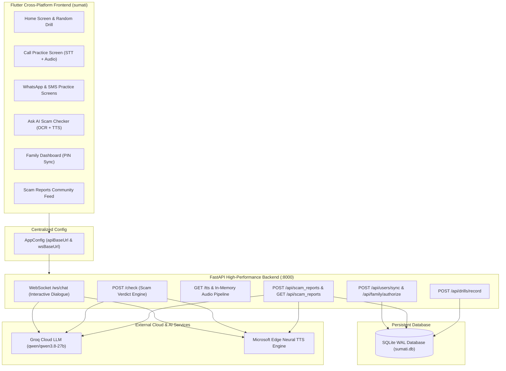

# 🛡️ SUMATI (सुमति सुरक्षा) — Senior Scam Defense & Cyber Reflex Simulator

[](https://flutter.dev)
[](https://fastapi.tiangolo.com)
[](https://groq.com)
[](https://github.com/rany2/edge-tts)
[](https://www.sqlite.org)
[](LICENSE)

> **"A flight simulator for cyber defense."**  
> Sumati protects senior citizens in India against cyber fraud through authentic, zero-risk, AI-powered scam simulations, live voice roleplay, community intelligence, and secure family monitoring.

---

## 📌 Table of Contents
1. [The Problem](#-the-problem)
2. [What is Sumati?](#-what-is-sumati)
3. [Key Features](#-key-features)
   - [Interactive Practice Modalities](#1-interactive-practice-modalities)
   - [Multilingual AI Roleplay & Voice Engine](#2-multilingual-ai-roleplay--voice-engine)
   - [Ask AI Scam Checker & Screenshot OCR](#3-ask-ai-scam-checker--screenshot-ocr)
   - [Emergency Cyber Checklist & 1930 Golden Hour](#4-emergency-cyber-checklist--1930-golden-hour)
   - [PIN-Protected Family Connect & Guardian Dashboard](#5-pin-protected-family-connect--guardian-dashboard)
   - [Crowdsourced Scam Intel Database](#6-crowdsourced-scam-intel-database)
4. [System Architecture](#-system-architecture)
5. [Database Schema](#-database-schema)
6. [Tech Stack](#-tech-stack)
7. [Installation & Local Setup](#-installation--local-setup)
8. [Cloud Deployment (Render / Docker)](#-cloud-deployment-render--docker)
9. [Project Directory Structure](#-project-directory-structure)

---

## 🚨 The Problem

Senior citizens in India are the primary targets of psychological cyber manipulation:
* **"Digital Arrest" Scams**: Impersonating Police/CBI claiming narcotics or money laundering seized under Aadhaar.
* **Electricity Cutoff Threats**: Late-night SMS/Calls threatening power disconnection unless paid via random APKs.
* **Bank KYC & OTP Fraud**: Urgent calls warning ATM cards or pensions will be blocked today.
* **Hospital Emergency Spoofs**: Impersonators claiming a son or grandchild is hospitalized and in critical condition.

**Why reading pamphlets fails:** Under extreme urgency and fear, reading advice does not create muscle memory. Seniors freeze and comply.  
**The Solution:** An interactive **flight simulator** where seniors safely experience these scams firsthand, practice refusal reflexes, and learn how to hang up, block, and report.

---

## 💡 What is Sumati?

**Sumati (सुमति)** is an accessible, senior-first Flutter application paired with an ultra-low-latency FastAPI backend. It provides:
1. **100% Safe Simulations**: No real money, links, or numbers are ever compromised.
2. **Accessible Senior Design**: 48px+ touch targets, high contrast, trilingual support (**English, हिंदी, मराठी**), and zero confusing technical jargon.
3. **Realistic Neural Speech**: Realistic Indian caller voices powered by Microsoft Edge-TTS neural models (`hi-IN-MadhurNeural` and `en-IN-PrabhatNeural`).
4. **Adaptive AI Scammer**: Driven by Groq Cloud (`qwen/qwen3.8-27b`) with dynamic multilingual code-switching that stays in character and adapts when the senior speaks Hindi or English.

---

## ✨ Key Features

### 1. Interactive Practice Modalities
* 📞 **Fake Voice Call Drill**: An authentic incoming calling interface with ringtone, caller ID, real-time microphone voice input, speech recognition, and live conversational scam dialogue.
* 💬 **WhatsApp Fraud Simulator**: Authentic WhatsApp interface complete with profile badges, end-to-end encryption notices, unknown sender warning banners (**[ 🚫 Block & Report ]** & **[ 🗑️ Delete Chat ]**), big voice read-aloud buttons, and suggested branch replies.
* ✉️ **SMS Phishing Practice**: Android Google Messages layout testing reflexes against fake bank lottery and electricity threat messages.
* 🌐 **Phishing Website Simulator**: Interactive browser simulation where users inspect fraudulent URLs, spot security red flags, and avoid entering sensitive credentials.

### 2. Multilingual AI Roleplay & Voice Engine
* **Dynamic Code-Switching**: If a senior asks *"हिंदी में बात करो"* or speaks in Hindi, the AI instantly switches to authentic Hindi in Devanagari script, staying strictly in character without ever saying *"I cannot speak Hindi"*.
* **Brisk Natural Pace (+18%)**: Voice synthesis is calibrated at `rate="+18%"` to replicate natural, human conversational telephone pacing rather than sluggish robotic narration.
* **In-Memory Streaming**: Synthesized audio is streamed and decoded entirely in RAM (base64) so backend disks never accumulate storage waste.

### 3. Ask AI Scam Checker & Screenshot OCR
* Seniors can paste suspicious WhatsApp messages, SMS texts, or URLs.
* **Camera / Screenshot OCR**: Extracts text from suspicious bills and screenshots using Google ML Kit on-device text recognition.
* **Verdict System**: AI analyzes the message and provides an immediate traffic-light verdict (**HIGH RISK**, **SUSPICIOUS**, **SAFE**), plain-language reasons, step-by-step guidance, and reads the advice aloud.

### 4. Emergency Cyber Checklist & 1930 Golden Hour
* Immediate, step-by-step triage for victims who were just targeted.
* Focuses on the **2-Hour Golden Window** to help victims call the **National Cyber Crime Helpline (1930)** to freeze illicit bank transfers.
* Features an **AI Voice Listener** where seniors can speak their distress and receive calm, spoken audio instructions.

### 5. PIN-Protected Family Connect & Guardian Dashboard
* **Zero Passwords**: The senior's app automatically generates a unique **4-digit Security PIN** (e.g. `5821`).
* **WhatsApp Share**: Seniors can tap one button to share their connection code with their children or guardians.
* **Remote Guardian Dashboard**: Family members connect using the senior's phone number and PIN to remotely view:
  - 🛡️ Senior's real-time **Safety Score** (0–100%).
  - 📊 Total drills completed, deflected, and fallen for.
  - 🚨 Real-time scam attempts reported by the senior.
  - 🕒 Live drill activity logs.

### 6. Crowdsourced Scam Intel Database
* **Share Scam & Scammer Details**: Seniors report scammer phone numbers, UPI IDs, fraudulent links, and story notes.
* **SQLite Database**: Persisted in `sumati.db` under WAL mode.
* **Community Intel Feed**: An in-app feed displaying total reports filed, unique scammer numbers flagged, and fake UPI IDs tracked to train future simulation drills.

---

## 🏗️ System Architecture



---

## 🗄️ Database Schema

The backend uses SQLite configured in **WAL (Write-Ahead Logging)** mode with busy timeouts to support high concurrent read/write throughput without table locks:

| Table | Primary Key | Key Columns | Purpose |
|---|---|---|---|
| `users` | `phone_number` | `name`, `pin`, `safety_score`, `total_drills`, `avoided_drills`, `last_active` | Tracks senior accounts and authorization PINs |
| `scam_reports` | `id` (Auto) | `user_phone`, `scammer_phone`, `scammer_upi`, `scammer_link`, `scam_amount`, `story`, `ai_analysis`, `created_at` | Stores crowdsourced scam intelligence |
| `family_connections` | `id` (Auto) | `senior_phone`, `family_phone`, `family_name`, `created_at` | Tracks authorized guardian connections |
| `drill_activity` | `id` (Auto) | `user_phone`, `scenario_title`, `channel`, `status`, `timestamp` | Real-time practice log for remote family viewing |

---

## 💻 Tech Stack

### Frontend (Mobile & Web)
* **Framework**: Flutter 3.x (Dart 3.x)
* **State Management**: Flutter Riverpod (`flutter_riverpod`)
* **Navigation**: GoRouter (`go_router`)
* **Local Storage**: Hive (`hive_flutter`)
* **Audio Engine**: `audioplayers`
* **On-Device OCR**: `google_mlkit_text_recognition`
* **Speech-to-Text**: `speech_to_text`

### Backend (AI & Cloud Services)
* **API Framework**: FastAPI / Starlette (ASGI)
* **Server**: Uvicorn (`uvicorn[standard]`)
* **LLM Engine**: Groq Cloud SDK (`qwen/qwen3.8-27b`)
* **Neural TTS**: `edge-tts` (Microsoft Neural Voice synthesis)
* **Database**: Embedded SQLite with WAL mode (`check_same_thread=False`)

---

## 🚀 Installation & Local Setup

### Prerequisites
* [Flutter SDK](https://docs.flutter.dev/get-started/install) (v3.19+)
* [Python 3.10+](https://www.python.org/downloads/)
* A free [Groq Cloud API Key](https://console.groq.com)

---

### 1. Backend Setup

```bash
# Navigate to backend directory
cd sumati/backend

# Create virtual environment
python -m venv venv
source venv/bin/activate        # On Windows: venv\Scripts\activate

# Install dependencies
pip install fastapi uvicorn websockets pydantic python-dotenv edge-tts groq requests

# Configure Environment Variables
# Create a .env file inside sumati/backend:
GROQ_API_KEY=gsk_your_groq_api_key_here
GROQ_MODEL=qwen/qwen3.8-27b
```

Run the backend server:
```bash
python -m uvicorn app.main:app --host 127.0.0.1 --port 8000 --reload
```
Backend will be live at `http://127.0.0.1:8000` (Docs: `http://127.0.0.1:8000/docs`).

---

### 2. Frontend Setup

```bash
# Navigate to the Flutter root directory
cd sumati

# Install Flutter dependencies
flutter pub get

# Launch on Chrome (Web)
flutter run -d chrome

# Or launch on an Android Device / Emulator
flutter run -d android
```

---

## ☁️ Cloud Deployment (Render / Docker)

### Deploying Backend to Render.com
1. Create a **New Web Service** on [Render](https://render.com) connected to your GitHub repository.
2. Set **Root Directory** to `sumati/backend`.
3. Set **Build Command**: `pip install -r requirements.txt` (or `pip install fastapi uvicorn websockets pydantic python-dotenv edge-tts groq`).
4. Set **Start Command**: `uvicorn app.main:app --host 0.0.0.0 --port $PORT`.
5. Add Environment Variables:
   - `GROQ_API_KEY`: Your Groq API key.
   - `GROQ_MODEL`: `qwen/qwen3.8-27b`.
   - `SUMATI_DB_DIR`: `/var/data` (attach a Render Persistent Disk for production storage).

### Connecting Flutter App to Live Render URL
Open [`lib/core/config/app_config.dart`](file:///C:/Users/Admin/Desktop/SUMATI_1.0/sumati/lib/core/config/app_config.dart) and paste your Render URL:
```dart
class AppConfig {
  static const String apiBaseUrl = String.fromEnvironment(
    'API_URL',
    defaultValue: 'https://your-service.onrender.com', // <-- Your live Render URL
  );
}
```

Or compile directly from the command line:
```bash
flutter build web --dart-define=API_URL=https://your-service.onrender.com
```

---

## 📂 Project Directory Structure

```
sumati/
├── backend/
│   ├── app/
│   │   ├── __init__.py
│   │   ├── main.py               # FastAPI endpoints, WebSockets & Groq streaming
│   │   └── db.py                 # SQLite WAL database manager & queries
│   ├── data/
│   │   └── sumati.db             # Persistent SQLite database file
│   └── requirements.txt
│
└── lib/
    ├── main.dart                 # Application entry point & Hive initialization
    ├── core/
    │   ├── config/
    │   │   └── app_config.dart   # Centralized API & WebSocket environment URLs
    │   ├── models/
    │   │   ├── scenario.dart
    │   │   └── simulation_result.dart
    │   ├── providers/
    │   │   ├── ai_call_provider.dart
    │   │   ├── ai_chat_provider.dart
    │   │   ├── preferences_provider.dart
    │   │   └── scenario_provider.dart
    │   ├── router/
    │   │   └── app_router.dart   # GoRouter navigation route registry
    │   ├── services/
    │   │   ├── realistic_voice_service.dart # Edge-TTS streaming audio player
    │   │   └── user_sync_service.dart       # Senior profile & family sync API
    │   └── theme/
    │       └── app_theme.dart    # Senior-friendly accessible colors & typography
    │
    └── features/
        ├── call_practice/        # Fake incoming call & live speech simulation
        ├── debrief/              # Scoring evaluation & defensive analysis
        ├── fake_android/         # System alert & notification popups
        ├── family/               # Remote Guardian Dashboard (PIN-based sync)
        ├── message_practice/     # WhatsApp & SMS scam drill interfaces
        ├── onboarding/           # Trilingual voice-guided welcome tour
        ├── scam_checker/         # Ask AI detector & Camera OCR scanner
        ├── scam_picker/          # Home screen & all 12 practice scenarios
        └── scammed_checklist/    # 1930 Cyber helpline & community intel feed
```

---

## 👥 Authors & Recognition
Developed with ❤️ to empower and protect senior citizens against cybercrime across India.  
For contributions or competition queries, submit a pull request or open an issue on GitHub!
