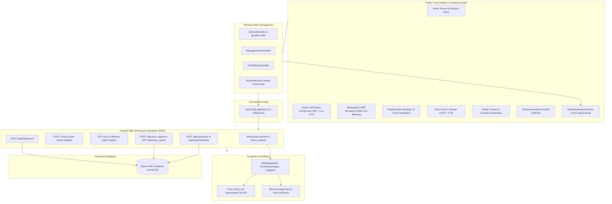

# 🛡️ SUMATI (सुमति सुरक्षा) — Senior Scam Defense & Cyber Reflex Simulator

[](https://flutter.dev)
[](https://fastapi.tiangolo.com)
[](https://groq.com)
[](https://github.com/rany2/edge-tts)
[](https://www.sqlite.org)
[](LICENSE)

> **"A flight simulator for cyber defense."**  
> Sumati protects senior citizens in India against cyber fraud through authentic, zero-risk, multi-agent AI scam simulations, continuous hands-free voice roleplay, dynamic cross-app attack orchestration, community intelligence, and secure family monitoring.

---

## 📌 Table of Contents
1. [The Problem](#-the-problem)
2. [What is Sumati?](#-what-is-sumati)
3. [Key Features](#-key-features)
   - [Interactive Practice Modalities](#1-interactive-practice-modalities)
   - [Continuous Hands-Free Voice Engine & VAD Auto-Mic](#2-continuous-hands-free-voice-engine--vad-auto-mic)
   - [Antigravity OS Multi-Agent Simulation & Cross-App Orchestration](#3-antigravity-os-multi-agent-simulation--cross-app-orchestration)
   - [Universal AI Scam Detection Checker (Voice & Text)](#4-universal-ai-scam-detection-checker-voice--text)
   - [Universal "Report Scam" & Post-Drill Analytics Debrief](#5-universal-report-scam--post-drill-analytics-debrief)
   - [Call & Notification Sound Engine](#6-call--notification-sound-engine)
   - [Ask AI Scam Checker & Screenshot OCR](#7-ask-ai-scam-checker--screenshot-ocr)
   - [PIN-Protected Family Connect & Guardian Dashboard](#8-pin-protected-family-connect--guardian-dashboard)
   - [Emergency Cyber Checklist & 1930 Golden Hour](#9-emergency-cyber-checklist--1930-golden-hour)
   - [Crowdsourced Scam Intel Database](#10-crowdsourced-scam-intel-database)
4. [System Architecture](#-system-architecture)
5. [Database Schema](#-database-schema)
6. [Tech Stack](#-tech-stack)
7. [Installation & Local Setup](#-installation--local-setup)
8. [Cloud Deployment (Render / Docker)](#-cloud-deployment-render--docker)
9. [Project Directory Structure](#-project-directory-structure)
10. [Automated Verification & Testing](#-automated-verification--testing)

---

## 🚨 The Problem

Senior citizens in India are the primary targets of psychological cyber manipulation:
* **"Digital Arrest" Intimidation**: Scammers posing as CBI / Cyber Crime Police alleging bank accounts or illegal parcels linked to the senior's Aadhaar under fictitious legal orders.
* **Electricity Cutoff Arrears**: Late-night SMS/Calls threatening immediate feeder disconnection unless cleared via phishing links or malicious APKs.
* **Banking KYC & Debit Card Freeze**: High-pressure warnings that ATM cards, pensions, or NetBanking will be suspended today.
* **Hospital / Family Emergency Spoofs**: Impersonators claiming a son, daughter, or grandchild had an accident and urgently requires hospital admission fees via UPI.

**Why reading pamphlets fails:** Under extreme urgency, emotional pressure, and fear, reading passive advice does not build muscle memory. Seniors freeze and comply.  
**The Solution:** An authentic, zero-risk **cyber flight simulator** where seniors experience realistic fraud across real-world digital channels (Voice Calls, WhatsApp, SMS, Web portals), build automatic refusal reflexes, and learn how to hang up, block, and report.

---

## 💡 What is Sumati?

**Sumati (सुमति)** is an accessible, senior-first Flutter application paired with an ultra-low-latency FastAPI multi-agent backend. It features:
1. **100% Zero-Risk Simulation**: Runs in an isolated sandbox where seniors practice against realistic attacks without risking money, credentials, or privacy.
2. **Accessible Senior Design**: 48px+ touch targets, high contrast, clean typography, trilingual voice guides (**English, हिंदी, मराठी**), and zero confusing technical jargon.
3. **Continuous Hands-Free Voice Interaction**: Automatic speech-to-text with voice activity detection (VAD), auto-rearming mic loops, and audio mutex locks that prevent double-talking.
4. **Context-Aware Non-Repeating AI**: Multi-turn dialogue memory prevents repetitive canned phrases and intelligently answers questions regarding legal sections, officer identity, or refusals.
5. **Cross-Platform & Web Ready**: 100% pure Dart & HTTP streaming with zero platform-dependent `dart:io` barriers—runs seamlessly on Android, iOS, and Web.

---

## ✨ Key Features

### 1. Interactive Practice Modalities
* 📞 **Fake Voice Call Drill**: Native calling interface with incoming ringtone, caller ID, real-time live voice recording, pulsing audio visualizer, live subtitles, and conversational scam dialogue.
* 💬 **WhatsApp Fraud Simulator**: Authentic WhatsApp layout with profile badges, end-to-end encryption notices, unknown sender warnings (**[ 🚫 Block & Report ]** & **[ 🗑️ Delete Chat ]**), voice read-aloud buttons, media document previews, and quick response chips.
* ✉️ **SMS Phishing Practice**: Android Google Messages layout testing reflexes against bank KYC freeze alerts and fake electricity bills.
* 🌐 **Phishing Website Simulator**: Full-screen simulated browser with an unverified SSL top bar, address bar inspection, and 3 distinct real-world phishing templates:
  - **Digital Arrest Device Lock**: 5-minute countdown, High Court seal, and fake legal settlement transfer.
  - **Virus Alert APK Trap**: 60-second countdown, simulated 28.4% system damage bar, and malicious `.apk` download trap.
  - **Banking KYC NetBanking Portal**: Urgent debit card unlock form with credential harvesting traps.
  - Floating red **"Exit Practice"** button so seniors can safely terminate web drills at any moment.

---

### 2. Continuous Hands-Free Voice Engine & VAD Auto-Mic
* **Self-Sustaining Auto-Listening**: When the caller finishes speaking, the microphone automatically turns ON and stays hot. If the user pauses or hesitates, the engine auto-re-arms so the mic never goes cold.
* **Real-Time Live Voice-to-Text**: Displays spoken words live on screen as the user speaks with a pulsing `REC` indicator and visual soundwave.
* **1.5s Silence Debounce**: Speech is automatically finalized and submitted to the caller 1.5 seconds after speaking ceases—no manual button taps required.
* **Audio Mutex Lock**: The microphone is strictly muted while the AI scammer speaks to eliminate acoustic feedback, echo, and double-talking.
* **Neural Voice Calibrated Pace (+18%)**: Realistic Indian caller voices powered by Microsoft Edge-TTS (`hi-IN-MadhurNeural` and `en-IN-PrabhatNeural`) calibrated for natural telephone cadence.

---

### 3. Antigravity OS Multi-Agent Simulation & Cross-App Orchestration
* **Multi-Modal Attack Coordination**: Orchestrates coordinated cross-app attacks. A voice scammer can dynamically trigger fake WhatsApp warrant images or SMS phishing links that drop down as native top-of-screen notification banners *over* the active call.
* **Global Notification Overlay**: Interactive system banner alerts allow seniors to inspect incoming cross-app messages without dropping the simulated call.

---

### 4. Universal AI Scam Detection Checker (Voice & Text)
* **Real-Time Pushback Detection**: Built-in regex and semantic analysis detects when a senior verbally or textually identifies fraud across English, Hindi, Hinglish, and Marathi (e.g., *"this is fake"*, *"police ko call karunga"*, *"I know this is a scam"*, *"section 144 is fraud"*).
* **Dynamic Deflection & Scammer Panic**: When detected, the scammer panics, disconnects, and leaves the chat (*"⚠️ Scammer disconnected and left the chat: Scam was recognized"*), awarding the user a successful deflection defense.

---

### 5. Universal "Report Scam" & Post-Drill Analytics Debrief
* **One-Tap Universal Report Action**: Every simulation screen (Call, WhatsApp, SMS, Web) features a prominent **"Report Scam"** button for immediate drill deflection.
* **Post-Scam Analytics Dashboard (Debrief)**: Complete defensive breakdown presenting three educational pillars:
  - 🎣 **The Hook**: The psychological lever used (Fear of arrest, urgency of power cutoff, emotional panic).
  - 💧 **The Leak**: What information the scammer attempted to extract (OTP, Aadhaar, NetBanking password).
  - 💡 **The Giveaway**: The dead giveaways and red flags to remember for the future.

---

### 6. Call & Notification Sound Engine
* **Native Incoming Ringtones**: Procedural dual-frequency bell tones for realistic incoming calls.
* **Message Notification Chimes**: Short, clean chimes when fake WhatsApp or SMS alerts arrive.
* **Zero-Leak Lifecycle**: Sound players automatically cease on call answer, decline, screen exit, or drill completion.

---

### 7. Ask AI Scam Checker & Screenshot OCR
* Seniors can paste suspicious WhatsApp forwards, SMS messages, or URLs for instant verification.
* **Camera / Screenshot OCR**: Extracts text from suspicious bills and screenshots using Google ML Kit on-device text recognition.
* **Traffic-Light Verdict**: Instant verdict (**HIGH RISK**, **SUSPICIOUS**, **SAFE**), plain-language explanations, and voice read-aloud guidance.

---

### 8. PIN-Protected Family Connect & Guardian Dashboard
* **Zero Passwords**: Seniors generate a unique **4-digit Security PIN** (e.g. `5821`).
* **One-Tap WhatsApp Share**: Seniors can share their connection code with children or guardians.
* **Remote Guardian Dashboard**: Guardians connect using the senior's phone number and PIN to monitor:
  - 🛡️ Senior's real-time **Safety Score** (0–100%).
  - 📊 Total drills completed, avoided, and compromised.
  - 🚨 Real-time scam attempts reported by the senior.
  - 🕒 Live drill activity history.

---

### 9. Emergency Cyber Checklist & 1930 Golden Hour
* Step-by-step triage for victims who were recently targeted by cyber fraud.
* Focuses on the **2-Hour Golden Window** to contact the **National Cyber Crime Helpline (1930)** to freeze unauthorized banking transactions.
* Features an **AI Voice Listener** where seniors can speak their distress and receive calm, spoken audio instructions.

---

### 10. Crowdsourced Scam Intel Database
* **Community Intel Feed**: Seniors report scammer phone numbers, UPI IDs, fraudulent URLs, and story notes.
* **SQLite Database**: Persisted in `sumati.db` under WAL mode.
* Tracked numbers and UPI accounts are dynamically repurposed to train future simulation drills.

---

## 🏗️ System Architecture



---

## 🗄️ Database Schema

The backend uses SQLite configured in **WAL (Write-Ahead Logging)** mode with busy timeouts to support high concurrent read/write throughput without table locks:

| Table | Primary Key | Key Columns | Purpose |
|---|---|---|---|
| `users` | `phone_number` | `name`, `pin`, `safety_score`, `total_drills`, `avoided_drills`, `last_active` | Tracks senior accounts and authorization PINs |
| `scam_reports` | `id` (Auto) | `user_phone`, `scammer_phone`, `scammer_upi`, `scammer_link`, `scam_amount`, `story`, `ai_analysis`, `created_at` | Stores crowdsourced scam intelligence |
| `family_connections` | `id` (Auto) | `senior_phone`, `family_phone`, `family_name`, `created_at` | Tracks authorized guardian connections |
| `drill_activity` | `id` (Auto) | `user_phone`, `scenario_title`, `channel`, `status`, `timestamp` | Real-time practice log for remote family viewing |

---

## 💻 Tech Stack

### Frontend (Mobile & Web)
* **Framework**: Flutter 3.x (Dart 3.x) — Web & Mobile Compatible (Zero `dart:io` in `lib/`)
* **State Management**: Flutter Riverpod (`flutter_riverpod`)
* **Navigation**: GoRouter (`go_router`)
* **Local Storage**: Hive (`hive_flutter`)
* **Audio Engine**: `audioplayers`
* **Voice Activity Detection & STT**: `speech_to_text` with auto-rearming silence debounce
* **On-Device OCR**: `google_mlkit_text_recognition`

### Backend (AI & Cloud Services)
* **API Framework**: FastAPI / Starlette (ASGI)
* **Server**: Uvicorn (`uvicorn[standard]`)
* **LLM Engine**: Groq Cloud SDK (`qwen/qwen3.8-27b`)
* **Neural TTS**: `edge-tts` (Microsoft Neural Voice synthesis)
* **Database**: Embedded SQLite with WAL mode (`check_same_thread=False`)

---

## 🚀 Installation & Local Setup

### Prerequisites
* [Flutter SDK](https://docs.flutter.dev/get-started/install) (v3.19+)
* [Python 3.10+](https://www.python.org/downloads/)
* A free [Groq Cloud API Key](https://console.groq.com)

---

### 1. Backend Setup

```bash
# Navigate to backend directory
cd sumati/backend

# Create virtual environment
python -m venv venv
source venv/bin/activate        # On Windows: venv\Scripts\activate

# Install dependencies
pip install fastapi uvicorn websockets pydantic python-dotenv edge-tts groq requests

# Configure Environment Variables
# Create a .env file inside sumati/backend:
GROQ_API_KEY=gsk_your_groq_api_key_here
GROQ_MODEL=qwen/qwen3.8-27b
```

Run the backend server:
```bash
python -m uvicorn app.main:app --host 127.0.0.1 --port 8000 --reload
```
Backend will be live at `http://127.0.0.1:8000` (Swagger Docs: `http://127.0.0.1:8000/docs`).

---

### 2. Frontend Setup

```bash
# Navigate to the Flutter root directory
cd sumati

# Install Flutter dependencies
flutter pub get

# Launch on Chrome (Web)
flutter run -d chrome

# Or launch on an Android Device / Emulator
flutter run -d android
```

---

## ☁️ Cloud Deployment (Render / Docker)

### Deploying Backend to Render.com
1. Create a **New Web Service** on [Render](https://render.com) connected to your GitHub repository.
2. Set **Root Directory** to `sumati/backend`.
3. Set **Build Command**: `pip install -r requirements.txt`.
4. Set **Start Command**: `uvicorn app.main:app --host 0.0.0.0 --port $PORT`.
5. Add Environment Variables:
   - `GROQ_API_KEY`: Your Groq API key.
   - `GROQ_MODEL`: `qwen/qwen3.8-27b`.
   - `SUMATI_DB_DIR`: `/var/data` (attach a Render Persistent Disk for production storage).

### Connecting Flutter App to Live Render URL
Open [`sumati/lib/core/config/app_config.dart`](file:///C:/Users/Admin/Desktop/SUMATI_1.0/sumati/lib/core/config/app_config.dart) and paste your live Render backend URL, or compile directly:
```bash
flutter build web --dart-define=API_URL=https://your-service.onrender.com
```

---

## 📂 Project Directory Structure

```
sumati/
├── backend/
│   ├── app/
│   │   ├── __init__.py
│   │   ├── main.py                  # FastAPI endpoints, WebSockets & Groq streaming
│   │   ├── db.py                    # SQLite WAL database manager & queries
│   │   └── agents/
│   │       ├── orchestrator.py      # Central multi-modal attack coordinator
│   │       ├── whatsapp_agent.py    # Non-repeating WhatsApp scam generator
│   │       ├── sms_agent.py         # Phishing SMS agent
│   │       ├── web_agent.py         # Phishing web portal agent
│   │       └── call_agent.py        # Voice call dialogue agent
│   ├── data/
│   │   ├── scenarios.json           # Scenarios master dataset
│   │   └── sumati.db                # Persistent SQLite database file
│   └── requirements.txt
│
└── lib/
    ├── main.dart                    # Application entry point & Hive initialization
    ├── core/
    │   ├── config/
    │   │   └── app_config.dart      # Centralized API & WebSocket environment URLs
    │   ├── models/
    │   │   ├── scenario.dart
    │   │   └── simulation_result.dart
    │   ├── providers/
    │   │   ├── ai_call_provider.dart # Voice call engine state & audio streaming
    │   │   ├── preferences_provider.dart
    │   │   └── scenario_provider.dart
    │   ├── router/
    │   │   └── app_router.dart      # GoRouter navigation route registry
    │   ├── services/
    │   │   ├── realistic_voice_service.dart # Edge-TTS streaming audio player
    │   │   ├── sound_effect_service.dart    # Ringtones & notification chimes
    │   │   └── user_sync_service.dart       # Senior profile & family sync API
    │   ├── utils/
    │   │   ├── scam_detection_checker.dart  # Multilingual pushback recognition
    │   │   └── simulation_trigger.dart
    │   └── widgets/
    │       └── global_notification_overlay.dart # Cross-app notification dropdown
    │
    └── features/
        ├── call_practice/           # Active voice call & hands-free VAD console
        ├── debrief/                 # Post-scam analytics report (The Hook, Leak, Giveaway)
        ├── family/                  # Remote Guardian Dashboard (PIN-based sync)
        ├── message_practice/        # WhatsApp & SMS scam drill interfaces
        ├── onboarding/              # Trilingual voice-guided welcome tour
        ├── scam_checker/            # Ask AI detector & Camera OCR scanner
        ├── scam_picker/             # Home screen & practice scenario selection
        ├── scammed_checklist/       # 1930 Cyber helpline & community intel feed
        └── web_practice/            # Phishing browser with 3 fraud templates
```

---

## 🧪 Automated Verification & Testing

SUMATI maintains a comprehensive automated test suite with **0 compiler or analyzer warnings**:

```bash
# Static Analysis (Zero Issues)
flutter analyze --no-pub lib test

# Execute Full Unit Test Suite (44/44 tests)
flutter test test/unit/

# Execute Widget & Simulation Drill Test Suite (38/38 tests)
flutter test test/widget/hands_free_mic_test.dart \
             test/widget/direct_debrief_routing_test.dart \
             test/widget/phase8_cross_app_and_hands_free_vad_test.dart \
             test/widget/call_and_message_ringtone_test.dart \
             test/widget/phase5_web_and_analytics_test.dart
```

---

## 👥 Authors & Recognition
Developed with ❤️ to empower and protect senior citizens against cybercrime across India.  
For contributions or competition queries, submit a pull request or open an issue on GitHub!
